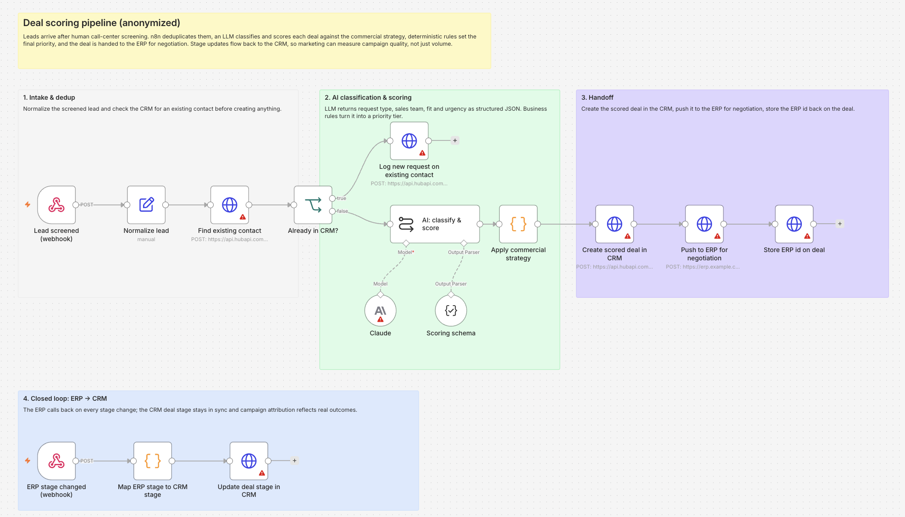

# Deal scoring pipeline (n8n + LLM)

An anonymized version of a deal scoring pipeline I built for a B2B client. Client names, endpoints and field values have been replaced with generic placeholders.

## The problem

The client received hundreds of leads a day from marketing campaigns. After a call-center screening, people sorted them by hand into sales teams, some of which were not even set up in the CRM. Sales worked from an unsorted list, and marketing could only judge campaigns by lead volume, with no signal on deal quality.

## What the workflow does

1. **Intake and dedup**: the screened lead arrives via webhook, gets normalized, and is checked against the CRM. Existing contacts get the new request logged as a note instead of a duplicate record.
2. **AI classification and scoring**: an LLM returns request type, sales team, fit and urgency as structured JSON, plus a one-line rationale for the rep.
3. **Commercial rules**: deterministic logic combines the AI output with deal value and strategic request types into a final score and a priority tier (A/B/C), and assigns the owner.
4. **Handoff**: the scored deal is created in the CRM, pushed to the ERP for negotiation, and the ERP id is stored back on the deal.
5. **Closed loop**: the ERP calls back on every stage change, and the CRM deal stage stays in sync.

## What changed

- Sales starts each day from a prioritized list instead of a raw one, with the reason for each priority visible on the deal.
- Manual sorting after screening disappeared; human judgment stays where it matters, in the screening call.
- Marketing can see which campaigns produce deals that get prioritized and closed, not just how many leads they bring in.

## Design choices

- **The LLM judges, the rules decide.** The model reads unstructured screening notes; the final priority comes from transparent business rules that sales leadership can change without touching the prompt.
- **Structured output** so every score is machine-readable and auditable.
- **One system of record per stage**: CRM for marketing and attribution, ERP for negotiation, synced in both directions.

## Stack

n8n · HubSpot CRM API · Anthropic Claude · ERP REST API
